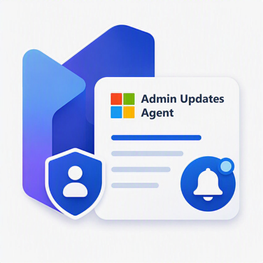
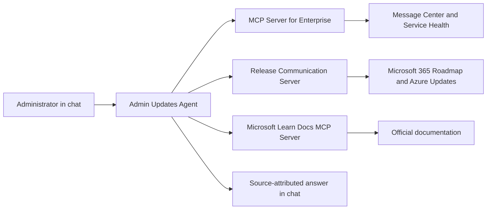

# Admin Updates Agent

A **chat-only Copilot Studio agent** for Microsoft 365 and Azure administrators. Ask about a specific product, request updates across all products, or investigate a change using tenant communications, public release information, and Microsoft Learn.

This is an independent community reference implementation. It is not developed, endorsed, or supported by Microsoft.

## What it does

- Search tenant Message Center posts and Service Health incidents or advisories.
- Search public Microsoft 365 Roadmap items and Azure Updates.
- Find official Microsoft Learn documentation, limitations, and remediation guidance.
- Correlate public changes with tenant evidence without confusing their authority.
- Produce an on-demand briefing in chat for the products and time range you ask for.

**No subscriptions or scheduled delivery.** There is no custom subscription table, digest flow, digest security role, delivery account, or email-domain configuration. The agent does not send email or post Teams cards. Using Teams as a chat channel is separate from automated Teams delivery.

Product choices apply to the conversation. They are not saved as subscription preferences across conversations. No product selection is required before chatting.

## Examples

- "What changed for Microsoft Teams in the last seven days?"
- "Show admin-impact updates across all products this week."
- "Is this roadmap feature rolling out to our tenant?"
- "Find the documented prerequisites and known issues for this change."

An all-products request means no product filter, not a guarantee that a source returned every record. The agent should state its date range, source coverage, and any limitations.

## Routing evaluations

Use the [25 natural-language test cases](evals/routing-test-set.csv) to check that ordinary admin questions reach the right sources without naming a server. The [capability expectations](evals/routing-expectations.csv) cover single-source lookups, combined investigations, past-dated roadmap verification, clarification and chat-only boundaries.

See [evaluation setup](SETUP.md#evaluate-natural-language-routing) for import instructions and actual tool-trace checks. Response quality alone does not prove correct tool routing.

## Install

1. Download [AdminUpdatesAgents_1_2_0_0.zip](solution/AdminUpdatesAgents_1_2_0_0.zip) and verify [SHA256SUMS.txt](solution/SHA256SUMS.txt).
2. Import it through **Power Apps > Solutions > Import solution**.
3. Configure the three centrally managed evidence-source connections, select an available model, and test.
4. Publish and share the agent only with the approved administrator security group when ready.

See [SETUP.md](SETUP.md) for the connection and permission steps, including guidance for an existing installation.

Copilot Studio and its Power Platform environment still have their normal platform and licensing requirements. Removing the custom subscription table does not remove any Dataverse requirement imposed by the platform.

The archive is an unmanaged solution. The filename and solution version remain `1.2.0.0`; verify the checksum to identify this chat-only build. A historical GitHub Release may still contain an older archive. Use the package linked above from the current branch.

## Architecture

| Source | Evidence role |
| --- | --- |
| MCP Server for Enterprise | Tenant communications and service health |
| Release Communication Server | Public releases and roadmap timing |
| Microsoft Learn Docs MCP Server | Documented behavior, prerequisites, known issues, and procedures |

Public information alone does not prove tenant impact. Source IDs, dates, status, links, and conflicts stay visible.

### HTML architecture view

Open [docs/index.html](docs/index.html) in a browser for the architecture, example requests, source roles, component inventory, and setup checklist.

GitHub's file browser shows HTML source, not the rendered dashboard. Download the file and open it locally, or configure GitHub Pages separately to host it.

## Repository layout

| Path | Contents |
| --- | --- |
| `settings.mcs.yml` | Agent identity, authentication, model, and instructions |
| `behaviors/cross-source-investigation/` | Cross-source investigation behavior |
| `capabilities/tools/` | Three MCP tool bindings |
| `connectors/` | Sanitized custom connector definitions |
| `infrastructure/connections/` | Three agent connection reference mappings |
| `settings/` | Additional Copilot Studio settings |
| `docs/` | HTML architecture dashboard |
| `evals/` | Natural-language routing evaluation CSV, capability expectations and local validation |
| `solution/` | Importable chat-only solution and checksum |

## Security and contributions

The agent requires Microsoft sign-in and uses centrally managed **Agent author authentication** (`Maker`) for its three MCP tools. A maintainer configures the connections once. Administrators who chat with the agent do not need Copilot Studio editing access or individual tool connections.

Enterprise MCP uses a dedicated service account with delegated access to the target tenant's Message Center and Service Health. An app registration identifies the connector but does not replace that user sign-in. Agent users share the connection's data access, not their individual tenant permissions. Restrict agent access to an approved administrator security group and review membership.

Deployers must use their own tenant's domain and tenant-specific connector configuration. No service-account credentials or live connections are included in the package. See [SETUP.md](SETUP.md#3-configure-the-three-evidence-sources) for setup, permission requirements, and connection maintenance.

Read [SECURITY.md](SECURITY.md) before deployment and [CONTRIBUTING.md](CONTRIBUTING.md) before making changes.

## License

Licensed under the [MIT License](LICENSE).
